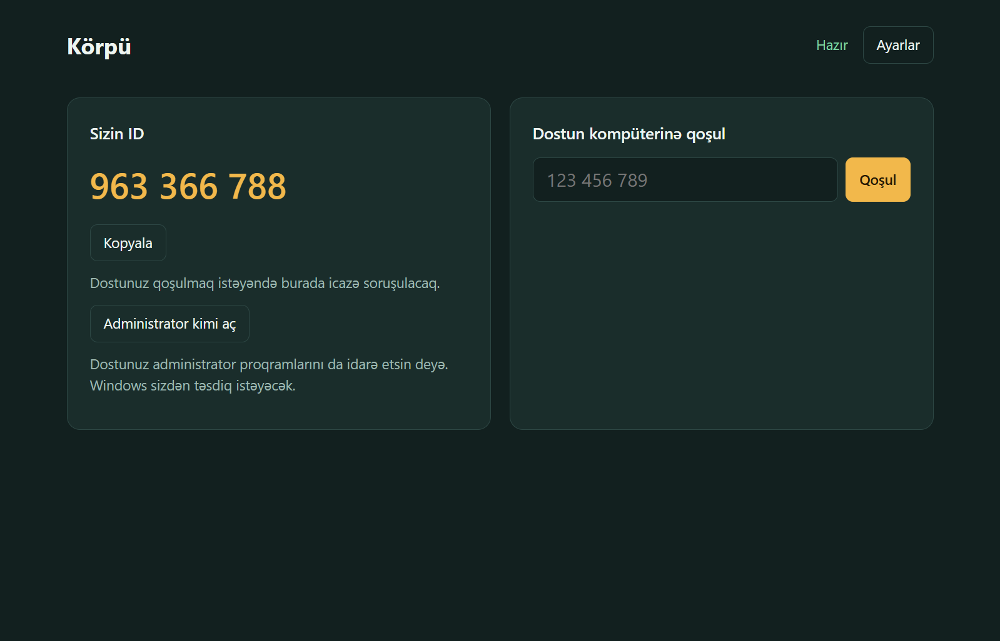

# Körpü

Dostunun kompüterinə ID ilə qoşul, ekranını gör və icazə versə, idarə et. Windows 10/11, 64 bit.

## [Sayta keç: təlimat və məlumat](https://m1staffa.github.io/korpu/)

## [Proqramı yüklə (ZIP, 103 MB)](https://github.com/m1staffa/korpu/releases/latest/download/Korpu-Windows.zip)



1. ZIP-i çıxar, `Korpu.exe` faylını aç.
2. **Ayarlar → Server açarı** yerinə səni dəvət edən dostun verdiyi açarı yaz.
3. Dostunun ID-sini yaz və **Qoşul** bas.

Proqram rəqəmsal imzasızdır, Windows xəbərdarlıq göstərə bilər. Yalnız buradan yüklə və kodu tutuşdur:

```text
SHA-256: afb36798c1306137e52852a1a6aa9bfb9ca871be944e33208c7a59537caa0c33
```

Tanımadığın adamın qoşulma sorğusunu qəbul etmə. Sessiyanı dərhal kəsmək: **Ctrl+Shift+F12**.
